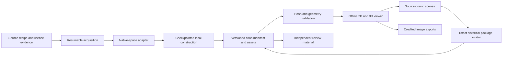

# Intracranial 2D and 3D atlas platform

The implemented general platform connects actual source image sections, native 3D geometry, stable structure IDs and reproducible scenes. Its scope is normal intracranial anatomy and normal variation. Disease states, lesion labels and diagnostic or treatment workflows remain outside the current phase. The [project scope](project-scope.md) defines the boundaries; this document distinguishes the current implementation from subsequent extensions.

Software and local atlases are separate products. Code, schemas, recipes and English documentation use the software release workflow. Users acquire data independently and construct local packages under each source's own terms. No downloaded images, segmentations, anatomical meshes, probability maps or streamlines enter software distributions. Publishing requires the owner's instruction. See the [scope](project-scope.md), [distribution policy](distribution-policy.md) and [practical workflow](getting-started.md).

## Implemented workflow

Each package retains its own native space. The common RAS millimetre convention is a coordinate description, not a registration between subjects or templates. Side-by-side comparison has independent selection, position, contrast and scene state in each panel. A shared name such as MNI does not establish correspondence.

Python modules separate source acquisition, catalogue adapters, construction, contracts, numerical validation, package discovery and review materials. The React/TypeScript viewer uses NiiVue 0.69.0 and local static assets. Browsing requires no external service. Python uses the independent `NeuroImage` environment; the frontend toolchain and build caches stay on SSD, while originals and atlas products stay on HDD.

## Source coverage

Version 1.0.0 retains 39 source configurations from 19 families, 1,965 source-specific entries and 46 detailed topics; see the [current inventory](../config/anatomy-release-1.0.0.json) and [browsing guide](learning-and-variation.md). The [15 October inventory](../config/anatomy-detail-inventory-2026-10-15.json) preserves an earlier increment. Teaching libraries, curricula, course management and learning tools remain in the testing branch; they are excluded from the formal application.

The following table documents the earlier eight-source baseline retained for comparison with the initial implementation:

| Source package | Actual representation | Entries | Draft sequences | Native context |
| --- | --- | ---: | ---: | --- |
| SPL/NAC | T1/T2 MRI, categorical labels and extracted surfaces | 105 | 8 | Same-volunteer A1 space; original image/label origin difference retained |
| CerebrA | T1/T2 templates, categorical labels and extracted surfaces | 102 | 8 | Explicitly matching MNI ICBM152 2009c symmetric grid |
| MIDA | Categorical model sections and extracted surfaces; no original MRI | 51 | 10 | Original oblique model grid, approximately 0.5 mm |
| CIT168 | T1/T2 templates, 16 exact probability channels and categorical navigation surfaces | 16 | 5 | Native 0.7 mm population template; source-inferred right side disclosed |
| Brainstem Navigator | Original probability fields, independent masks and source surfaces | 86 | 9 | Explicitly paired MNI template; 76 brainstem and ten diencephalic source fields, with overlaps and subdivisions retained |
| HCP1065 | Native computational trajectories and publisher-declared reference MRI | 87 | 14 | Original ICBM 2009a asymmetric RAS coordinates |
| Mouches/Forkert | Original arterial-occurrence percent field, matched average TOF and a derived display mask | 1 | 1 | Delivered shared grid; no assumed correspondence to another template |
| IXI MRA | One original native NIfTI image and its source intensity display | 0 | 0 | Single acquired oblique slab; no source structure labels or inferred cross-image alignment |

The baseline's 448 entries are source-specific catalogue entries, not 448 unique anatomical entities or cross-source equivalents. Its sequence counts describe historical metadata retained in existing atlas packages, not a current browser feature. These historical counts do not replace the current inventory above. All sources use the same adapter, construction, manifest, validation, browser and export interfaces; license terms are individual metadata and do not define platform tiers.

SPL/NAC contains 70 cortical, 18 deep, seven ventricular, three brainstem, four cerebellar and three white-matter-context entries. CerebrA contains 62 cortical, 20 deep, eight ventricular, two brainstem and ten cerebellar entries. These counts describe the delivered parcellations and selected groups, not exhaustive nuclei, folia or individual functional areas. MIDA contributes separately labelled intracranial model components, including four categorical pathway regions; those regions are not tractography. CIT168 contributes 11 deep and five brainstem source regions with their probability evidence.

Normal variation is within scope, but the current viewer does not estimate its prevalence or provide a reviewed multi-subject variation curriculum. Different source templates and models cannot by themselves establish a distribution of normal anatomy.

## Geometry and evidence boundaries

Adapters retain source definitions, versions, license evidence and native arrays. NRRD LPS geometry is represented in RAS through the affine; NIfTI coded forms, units, shear and oblique directions are checked explicitly. Undeclared units require recorded source evidence. Conflicting coded forms are rejected. No new cross-source registration, mirroring or interpolation creates anatomy.

Categorical surfaces use the full-resolution binary 0.5 isosurface with no smoothing or decimation. Every extracted vertex is checked against that source boundary. Ambiguous marching-cubes topology remains explicit and is not repaired into assumed anatomical continuity. Source label counts, actual member-voxel targets and geometry are checked independently of renderer state.

A probability channel retains its original values, grid, source channel number, interpretation and derivation. The viewer loads the selected channel on demand. Navigation surfaces follow a declared source map or an explicitly recorded project display threshold; this relationship is verified. Source fraction and percent units are distinct, and the unchanged full probability field remains available. Observer counts, population averaging or an inferred hemisphere are source-specific facts, not generic probability semantics.

Native images, source labels, computational surfaces and user scene notes represent different evidence. Engineering consistency does not establish anatomical accuracy or expert acceptance. [Independent review material](anatomical-review.md) remains tied to exact package versions and starts with no judgments.

## Interaction and saved views

The three orthogonal sections and 3D view share a physical cursor. Structure selection moves to an actual labelled member voxel. Section clicks sample the categorical source; surface clicks resolve nearby visible geometry and retain ambiguous candidate information. Orientation conventions change presentation without changing the source affine or anatomical side.

Users control structure visibility, opacity, contrast, layout, 3D magnification and section pan. Full sections provide global context before cursor-centered magnification. A saved native-RAS cutaway can hide one half-space of selected 3D source surfaces while leaving all 2D sections and original geometry unchanged; no cap or internal anatomy is generated. Historical scene annotations retain native coordinates and source association. Scene files preserve the anatomical display state. Imports must match package ID, version, build signature and native space. Retired lesson and practice state is ignored.

Exports retain the rendered image, exact scene, complete source/processing declarations, rendering policy, source license notices and any retained scene notes.

`neuroimage library` discovers existing complete and interrupted builds. `neuroimage locate` finds the exact package required by a saved scene. Completed construction reuses intact assets without decompression or geometry work. Startup always checks every asset hash and may reuse unchanged successful geometry checks; explicit validation recomputes geometry.

## Next bounded increments

1. Obtain independent anatomical review of source-specific structure cases. Record judgments and resolve requested corrections without manufacturing an approval state.
2. Use browsing sessions to refine navigation and source-definition explanations. Preserve reproducible scenes for reported problems.
3. Add one specialist evidence type at a time only after checking its source definitions, coordinate relationships, coverage, license evidence and validation method. Extend contracts when the representation requires it.

HCP source trajectories and independent probability regions have distinct, validated representations. Delivered vascular, cranial-nerve and skull context uses the same source-specific acquisition and package workflow; cisternal observation points remain teaching annotations rather than inferred compartment segmentations. See [specialist coverage](specialist-modules.md) and the current inventory for the precise limitations. Selected Julich-Brain, BigBrain, NextBrain and IXI configurations are implemented; additional acquisitions or representations require separate evaluation. New evidence must not be forced into another representation or registered merely for visual convenience. Other retained datasets and user originals remain intact.

The [release-candidate validation record](release-candidate-validation.md) distinguishes current checks from historical development receipts. Expert review is separate from engineering acceptance, and no engineering milestone establishes completion of independent anatomical or educational evaluation. See the [adapter development guide](adapter-development.md) for extension responsibilities and verification.
